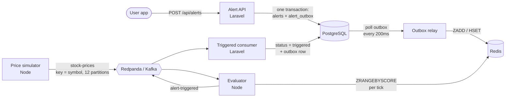

# Stock Alerts

A real-time stock price alert system, built to practise system design: users set "tell me when AAPL goes above 190", prices stream in at thousands of ticks per second, and matching alerts fire in milliseconds.

**▶ [Watch the animated walkthrough](https://abo3ish.github.io/stock-alerts/)** (creating an alert, a price tick, an alert firing, and a Redis outage).

## Architecture



| Component | Stack | Role |
|---|---|---|
| `alert-api/` | Laravel 13, PostgreSQL | REST API for alerts; the source of truth |
| Outbox relay | `php artisan alerts:relay` | Copies changed alerts from Postgres to Redis |
| `engine/src/simulator.ts` | Node, kafkajs | Produces random-walk prices for 5,000 real tickers |
| `engine/src/evaluator.ts` | Node, kafkajs, ioredis | Finds the alerts each tick satisfies and publishes them |
| Triggered consumer | `php artisan alerts:consume-triggered` | Marks fired alerts as triggered |

## Design decisions

- **Transactional outbox, not dual write.** The API never touches Redis. It writes the alert and an `alert_outbox` row in one Postgres transaction; the relay syncs Redis afterwards. A Redis outage delays the cache, it never loses an alert or fails a request.
- **The relay syncs state, not events.** Each outbox row means "alert 42 changed": the relay reads its current row and writes that. Replays and duplicates are harmless.
- **Redis sorted sets as a price index.** `alerts:above:{SYM}` and `alerts:below:{SYM}` (member = alert id, score = target price) let the evaluator ask for only the satisfied range, with details in `alerts:data:{SYM}`. A symbol with 100k alerts costs O(log n + matches) per tick instead of loading all 100k.
- **Partition by symbol.** Every tick of a symbol lands on the same partition, so one evaluator owns it and sees its prices in order. 12 partitions = up to 12 evaluators.
- **Idempotent consumer.** `UPDATE ... WHERE status = 'active'` makes a redelivered `alert-triggered` event change nothing.

## Benchmark

1M alerts (100k on AAPL), 2,000 ticks/s, one evaluator, `./bench.sh 60 2000`:

| Redis layout | Ticks/s handled | Busy | Lag (avg / max) | Kafka lag at the end |
|---|---|---|---|---|
| Hash per symbol (load all, filter in Node) | 1,679 | 99% | 10.5 s / 18.4 s | 24,960 |
| Sorted sets (range query) | 1,998 | 50% | 31 ms / 171 ms | 0 |

## Running it

Requires Docker, Node 23+, and PHP 8.4 with Composer ([Laravel Herd](https://herd.laravel.com) serves the API at `http://api.alerts.test`).

```bash
(cd alert-api && composer install && cp .env.example .env && php artisan key:generate && herd link api.alerts)
docker compose up -d                       # Redpanda, Redis, Postgres, relay, consumer
docker compose exec postgres createdb -U alerts alerts_test   # for the Pest suite
(cd alert-api && php artisan migrate)
cd engine && npm install
npm run simulator                          # in one terminal
npm run evaluator                          # in another
```

Create an alert:

```bash
curl -X POST http://api.alerts.test/api/alerts -H 'Content-Type: application/json' \
  -d '{"user_id":7,"symbol":"AAPL","condition":"above","target_price":190}'
```

| | |
|---|---|
| Redpanda Console | http://localhost:8080 |
| Kafka (host) | `localhost:19092` |
| Postgres | `localhost:5433` (user/password in `docker-compose.yml`) |
| Redis | `localhost:6380` |

Load test: `php artisan db:seed --class=LoadTestSeeder`, then `php artisan alerts:rebuild-cache`, then `./bench.sh [seconds] [ticks-per-second]`.

Tests: `cd alert-api && ./vendor/bin/pest` (uses the `alerts_test` database and Redis DB 1) and `cd engine && npm test`.
